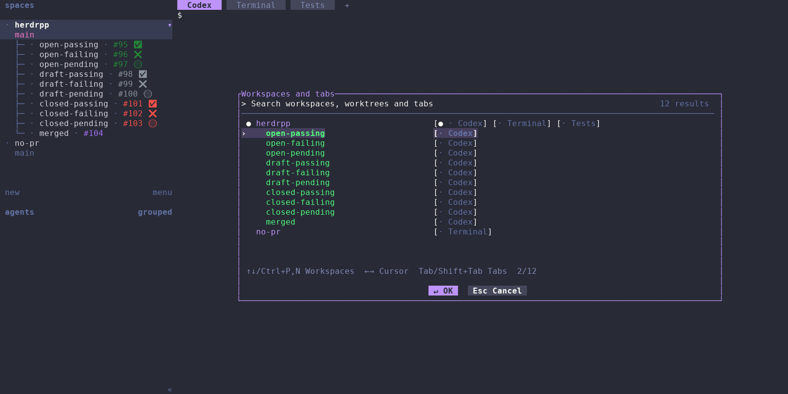

# herdr++

Search open workspaces, worktrees, and tabs, and see GitHub pull request status
beside each workspace in Herdr.



Workspace search alongside all nine open/draft/closed × passing/failing/pending
combinations, plus a merged PR and a workspace without a PR. Open PRs are green,
drafts gray, closed PRs red, and merged PRs purple; CI uses ✅, ❌, and 🟡.

## Installation

Requires macOS or Linux, Herdr 0.9.5+, Git, Rust/Cargo 1.89+, curl, Python 3,
and authenticated [GitHub CLI](https://cli.github.com/) for PR status.
The picker itself does not require Git or GitHub authentication.

```sh
curl -fsSL https://raw.githubusercontent.com/kamaal111/herdrpp/main/install.sh | bash
```

The installer installs the latest stable release at its exact tag, initializes
PR sidebar tokens and available Cmd+P and Cmd+Shift+K shortcuts, and requests watcher startup
when a session is running. It also installs a persistent local `herdrpp` binary
at `${XDG_BIN_HOME:-$HOME/.local/bin}/herdrpp`. Add that directory to your PATH.
Authenticate `gh` on the server with `gh auth login`.
Then select **Reload config** in the viewing client's menu. If either shortcut is already
bound, setup preserves it and reports how to add another shortcut.

Rerun the same command to update to the latest release. Setup is recorded once
per resolved config path outside the plugin installation. Later installs apply only new targeted setup migrations and preserve
intentional edits or removals from completed migrations. The
public installer requires the first GitHub Release to have been published.

### Separate server and viewing computer

Install on the server without changing its viewing configuration:

```sh
curl -fsSL https://raw.githubusercontent.com/kamaal111/herdrpp/main/install.sh | bash -s -- --plugin-only
```

Configure the viewing computer without registering a plugin:

```sh
curl -fsSL https://raw.githubusercontent.com/kamaal111/herdrpp/main/install.sh | bash -s -- --config-only
```

Config-only mode requires curl, Python 3, tar, and Rust/Cargo. It builds the
launcher in a temporary directory, copies the executable to
`${XDG_BIN_HOME:-$HOME/.local/bin}/herdrpp`, and removes build files afterward.
It needs no running Herdr server, `gh`, or GitHub authentication. Windows
viewing clients can use the manual configuration below.

The installer honors `HERDR_BIN_PATH`, `HERDR_CONFIG_PATH`, `XDG_STATE_HOME`,
and `XDG_BIN_HOME`. Plugin-only mode leaves the local launcher untouched.
Use `bash install.sh --help` or `bash install.sh --dry-run` in a checkout to
inspect it without changing your installation.

### Manual source installation

```sh
herdr plugin install kamaal111/herdrpp
herdr plugin action invoke herdrpp.start
herdr plugin action invoke herdrpp.open
```

Source installations without `--ref` follow `main`; update them with
`herdr plugin update herdrpp`. The scripted installer pins a release, so rerun
that installer to select a newer release. For multiple sessions, invoke start
in each, for example `herdr --session work plugin action invoke herdrpp.start`.
The startup hook starts automatic refresh when the server starts.

## Viewing configuration

Edit the config on the computer displaying Herdr, normally
`~/.config/herdr/config.toml` or `%APPDATA%\herdr\config.toml` on Windows.
`HERDR_CONFIG_PATH` overrides the location. Merge the
[example configuration](examples/herdr.toml) into your existing file.

```toml
[[keys.command]]
key = "cmd+p"
type = "plugin_action"
command = "herdrpp.open"
description = "Search workspaces, worktrees and tabs"

[[keys.command]]
key = "cmd+shift+k"
type = "plugin_action"
command = "herdrpp.commands"
description = "Open command palette"

[ui.sidebar.spaces]
rows = [
  [
    "state_icon", "workspace",
    { token = "$pr_open", fg = "#238636" },
    { token = "$pr_draft", fg = "#8b949e" },
    { token = "$pr_merged", fg = "#a371f7" },
    { token = "$pr_closed", fg = "#f85149" },
  ],
  ["branch", "git_status"],
]
```

Select **Reload config** in the viewing client. Server reload commands do not
reload a remote client's layout. If your terminal intercepts Cmd+P, use
`key = "prefix+f"` and press the Herdr prefix (default Ctrl+B), then `f`.

The explicit `herdrpp configure` command owns automatic viewing setup. It
preserves comments, custom styles, unrelated settings, and existing bindings.
Invalid TOML or unsupported layouts fail without changing the config. State
and original-file backups live under
`${XDG_STATE_HOME:-$HOME/.local/state}/herdrpp/configs/`. Retain these records
to preserve once-only setup. Runtime actions never modify settings.

## Workspace search

Search is case-insensitive and fuzzy. Every space-separated term must match;
terms can match different workspace, worktree, or tab names in the hierarchy.
For example, `demo feature codex` finds the Codex tab in demo's feature worktree.

Hierarchical mode indents linked worktrees and keeps matching ancestors
visible. Flat mode shows ancestor breadcrumbs. Both modes rank searches by
match quality: workspace rows by their strongest destination and tabs within
each row by relevance. The strongest workspace or tab is selected immediately;
Enter opens it. Equal scores prefer a workspace, then existing display order.
Ranked worktrees can appear before their roots. Tabs appear beside their owners.

Locate the plugin settings with `herdr plugin config-dir herdrpp`, and create
`config.toml` there:

```toml
[picker]
search_mode = "flat"
```

Use `"hierarchical"` or omit the file for the default. Unknown fields and other
mode values are errors. See [plugin settings](examples/config.toml).

| Input | Action |
| --- | --- |
| Typing / paste | Filter immediately |
| ↑ / Ctrl+P | Previous workspace or worktree |
| ↓ / Ctrl+N | Next workspace or worktree |
| → / Tab | Next displayed tab from the highlighted tab, wrapping |
| ← / Shift+Tab | Previous displayed tab from the highlighted tab, wrapping |
| Enter / click ↵ OK | Focus selection and exit |
| Esc / Ctrl+C / click Esc Cancel | Exit without switching |
| Left click | Focus the clicked workspace or tab and exit |
| Mouse wheel | Move through workspace rows and scroll |

Selecting a workspace highlights both its name and its remembered tab, so
Enter's destination is visible. The remembered tab remains available even when
it does not match the search. Arrow/Tab navigation cycles from that highlighted
tab. Selecting a workspace restores its remembered tab and pane; selecting a
tab focuses it explicitly. Up/down clears tab selection and stops at the first
or last workspace row. `●` marks the active destination; `›` marks selection.
Enter does nothing without results. Outside clicks are ignored.

The picker follows Herdr's saved theme, custom colors, and terminal appearance
reports. Reopen after saving theme changes. Unsaved Settings previews are
unavailable. Palette compatibility is based on Herdr 0.9.5.

The popup is centered, 80% wide, and at most 22 rows tall. It searches open
destinations in the selected local session, fetching them once per opening.
Without a search, the current workspace group appears first, followed by
Herdr's workspace order; initial selection is the first other workspace. There
is no MRU history or branch-label search. Reopen to discover changed destinations.

## Command palette

Press **Cmd+Shift+K** to search commands, or invoke
`herdr plugin action invoke herdrpp.commands`. Ghostty's Cmd+Shift+P remains
available for its own palette. After installation, select **Reload config**
in the viewing client. If your terminal reserves the chord, configure
`key = "prefix+shift+f"` instead (default Ctrl+B, then Shift+F).

The command palette uses the workspace picker's shared search algorithm and
search view: case-insensitive fuzzy matching, all whitespace-separated terms
required, immediate filtering, score ranking, and highlighted matching letters.
Search command titles, descriptions, plugin names, or qualified action IDs.
Empty searches show commands alphabetically; there is no command history.

Built-ins include workspace search; creating, renaming, and closing workspaces
or tabs; renaming and closing panes; splitting right/down; focusing neighboring
panes; and toggling zoom. Enabled plugin actions appear alongside them, filtered
by platform and available invocation context. Custom `[[keys.command]]` entries
and client-only actions such as Settings, Help, and Toggle Sidebar are outside
this version's coverage. Discovery failures leave built-ins available with a
warning; reopen to refresh the catalog.

Type or paste to filter, use ↑/↓ or Ctrl+P/N, and press Enter or click a result
to run it. Rename commands ask for a nonblank name. Close commands require
confirmation. Escape returns from a prompt or closes the palette; Ctrl+C cancels.
Commands target the workspace, tab, and pane that opened the palette. A missing
original target produces an error rather than switching to another target.
Plugin actions are requested asynchronously; use Herdr's plugin logs to confirm
completion. The palette uses the same compact native popup as workspace search:
80% wide and at most 22 rows, keeping the surrounding terminal visible. It closes before
dispatch so another action can open a popup, including the workspace picker.

Setup version 2 adds only the Cmd+Shift+K binding to installations that already
completed version 1. It preserves removed sidebar tokens and Cmd+P bindings.
Subsequent installs do not restore a deliberately removed palette shortcut.
Existing conflicting shortcuts are preserved and reported for manual setup.
## Machine search

The launcher is verified with Herdr **0.9.5** on macOS and Linux. Start Herdr
through it on the viewing computer:

```sh
herdrpp launch --session default
# Or start at an existing enabled machine profile:
herdrpp launch --machine PROFILE_ID --session default
```

To try this branch from its checkout on the viewing computer:

```sh
just plugin-link
./target/release/herdrpp launch
```

`plugin-link` already builds release. Start the launcher from a local terminal;
linking the plugin alone does not enable machine switching in a normally started
Herdr client. No Herdr source changes or additional viewing config edits are
required.

Open the workspace picker with its configured shortcut (default **Cmd+P**)
or **Ctrl+]**. Inside that same picker, **PageUp/PageDown** or the header arrows
cycle through Local and enabled saved machines. The header identifies the
machine, session, and profile. Search and workspace/tab navigation apply to the
machine being browsed; search text is retained when cycling. Browsing is read-only:
**Enter** attaches and focuses the selected workspace or tab, while **Esc** leaves
the original attachment unchanged. Loading, empty, and unavailable machines cannot
be activated. Failed selections reopen the picker with an error; failed-destination
typeahead is discarded. **Ctrl+\** exits the launcher without stopping servers.

The picker runs on the viewing computer; remote machines do not need this plugin
installed for machine browsing. The ordinary `herdrpp.open` server-side popup
outside the launcher remains scoped to its attached server. The launcher recognizes
its configured picker keyboard shortcut locally; invoking a plugin action through
a separate CLI process does not address the launcher.

Run `herdr machine list --json` to inspect profile IDs. The local session passed
to the launcher is retained; each remote profile supplies its own SSH target and
session. Profile IDs identify destinations even when display names or workspace
IDs overlap. A profile changed during browsing must be selected again.

This alternative changes machines by detaching the owned viewing client and
starting another Herdr attachment. Server sessions and busy panes continue
running. A failed preflight keeps the current attachment; if a replacement
exits with an error, the launcher attempts to reattach the prior destination.
Typing queued for a failed switch is discarded before input resumes on the
prior attachment. It never stops Herdr servers. Each owned viewing client
displays one endpoint;
use this picker for machine changes. Native GoTo continues to navigate the
current server's workspaces. Manage saved profiles with the regular
`herdr machine` CLI outside the launcher. The launcher leaves the global catalog
and remembered native machine selection unchanged. Adding profiles through the
owned client's native Machines UI is unsupported and stops the launcher with a
preserved recovery directory. Native sidebar preferences are reconciled with
your normal viewing preferences; conflicting edits are preserved and reported.
The standalone workspace picker retains its existing server-local scope.

## Pull request status

The expanded desktop sidebar shows the newest associated GitHub PR by creation
date, matching the exact head repository and branch across all states. Linked
worktrees are independent. Open PR numbers are green, draft gray, merged purple,
and closed red. Checks show ✅ passed, ❌ failed, or 🟡 pending. Merged PRs and PRs
without actionable checks omit the check icon.

```sh
herdr plugin action invoke herdrpp.refresh
herdr plugin action invoke herdrpp.stop
herdr plugin action invoke herdrpp.start
```

Refresh performs one cycle without starting a watcher. Automatic refresh runs
immediately, then waits 60 seconds after each completed cycle. Lookups run
sequentially. All reported checks count, including optional checks; failure
wins over pending, then passing, and neutral/skipped checks are ignored.

GitHub Enterprise hosts authenticated through `gh` are supported. Detached
HEAD, non-Git directories, and local-only remotes have no association. Lookup
failures preserve previous metadata until its 180-second expiry; confirmed
empty results clear it. Stop, disable, and unlink leave displayed tokens to
expire. Run start after re-enabling or recovering an exited watcher.

Closing or reconnecting a client does not stop the watcher. Running watchers
notice binary or installation changes between refresh cycles. The launcher is
not a crash supervisor. Collapsed/mobile layouts are controlled by Herdr.

## Troubleshooting

- **Missing picker:** inspect `herdr plugin list`, close other modals, and try
  `herdr plugin action invoke herdrpp.open` directly. Check terminal forwarding
  and mouse capture if input is unavailable.
- **No server:** inspect `herdr status server` and the selected session.
  `HERDR_BIN_PATH` selects another executable. Escape cancels discovery.
- **Closed destination:** the picker exits and attempts original-focus
  restoration. Reopen for fresh results. Errors reach stderr and Herdr
  notifications, subject to Herdr's `[ui.toast]` settings.
- **Machine connection:** inspect `herdr machine status PROFILE_ID --json`.
  Run `herdr machine reconnect PROFILE_ID` outside the launcher when SSH needs
  authentication. Failed checks retain the current viewing attachment.
- **Local launcher missing:** add `${XDG_BIN_HOME:-$HOME/.local/bin}` to PATH,
  or invoke its `herdrpp` executable directly with `launch`.
- **PR missing:** verify the viewing client's tokens, reload config, and expand
  repository groups. Inspect `herdr workspace get WORKSPACE_ID` on the server;
  populated metadata indicates a client layout issue.
- **PR lookup:** run `just plugin-check-pr` in a checkout or the installed
  `target/release/herdrpp check-pr`. Verify the branch, remote, and `gh` access.
- **Action errors:** inspect `herdr plugin log list --plugin herdrpp --limit 5`.
  Action invocations are asynchronous; `running` is not confirmation of success.
  Start prints the watch log path for per-workspace diagnostics.

## Development and license

See [development and releases](docs/development.md) and
[focus and snapshot testing](docs/snapshots.md).

Project code is [MIT licensed](LICENSE). Adapted Herdr palette code retains
Apache-2.0 attribution in [src/picker/theme.rs](src/picker/theme.rs) and
[LICENSES/Herdr-Apache-2.0.txt](LICENSES/Herdr-Apache-2.0.txt).
Snapshot fonts retain their [DejaVu](tests/snapshots/fonts/LICENSE) and
[Noto Emoji](tests/snapshots/fonts/NotoEmoji-LICENSE.txt) licenses.
