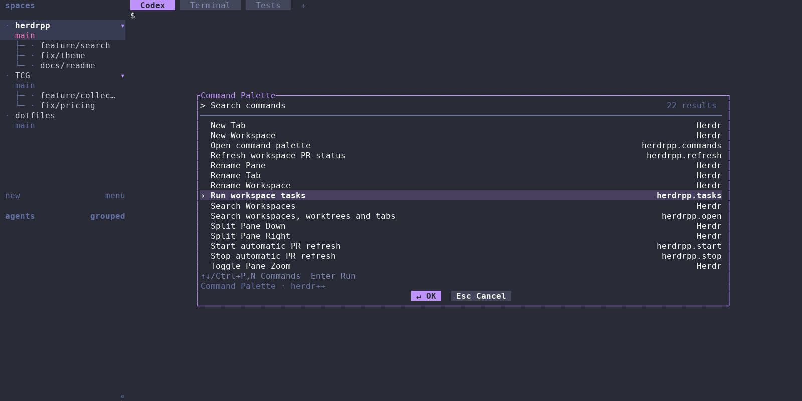
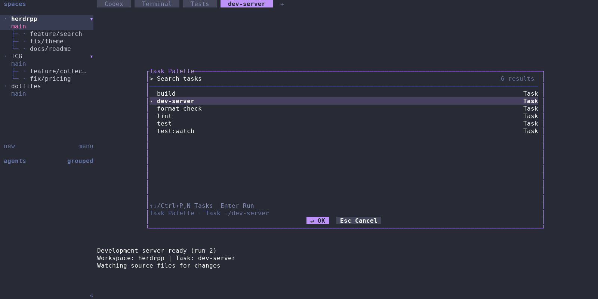

# herdr++

Search open workspaces, worktrees, and tabs, and see GitHub pull request status
beside each workspace in Herdr.


Workspace search alongside all nine open/draft/closed × passing/failing/pending
combinations, plus a merged PR and a workspace without a PR. Open PRs are green,
drafts gray, closed PRs red, and merged PRs purple; CI uses ✅, ❌, and 🟡.

## Installation

Requires macOS or Linux, Herdr 0.9.5+, Git, Rust/Cargo 1.89+, curl, Python 3,
and authenticated [GitHub CLI](https://cli.github.com/) for PR status.
The picker itself does not require Git or GitHub authentication.

```sh
curl -fsSL https://raw.githubusercontent.com/kamaal111/herdrpp/main/install.sh | bash
```

The installer installs the latest stable release at its exact tag, initializes
PR sidebar tokens and available Cmd+P and Cmd+Shift+K shortcuts, and requests watcher startup
when a session is running. Authenticate `gh` on the server with `gh auth login`.
Then select **Reload config** in the viewing client's menu. If either shortcut is already
bound, setup preserves it and reports how to add another shortcut.

Rerun the same command to update to the latest release. Setup is recorded once
per resolved config path outside the plugin installation. Later installs apply only new targeted setup migrations and preserve
intentional edits or removals from completed migrations. The
public installer requires the first GitHub Release to have been published.

### Separate server and viewing computer

Install on the server without changing its viewing configuration:

```sh
curl -fsSL https://raw.githubusercontent.com/kamaal111/herdrpp/main/install.sh | bash -s -- --plugin-only
```

Configure the viewing computer without registering a plugin:

```sh
curl -fsSL https://raw.githubusercontent.com/kamaal111/herdrpp/main/install.sh | bash -s -- --config-only
```

Config-only mode requires curl, Python 3, tar, and Rust/Cargo. It builds the
configuration helper in a temporary directory and removes it afterward. It
needs no Herdr server, `gh`, or GitHub authentication. Windows viewing clients
can use the manual configuration below.

The installer honors `HERDR_BIN_PATH`, `HERDR_CONFIG_PATH`, and `XDG_STATE_HOME`.
Use `bash install.sh --help` or `bash install.sh --dry-run` in a checkout to
inspect it without changing your installation.

### Manual source installation

```sh
herdr plugin install kamaal111/herdrpp
herdr plugin action invoke herdrpp.start
herdr plugin action invoke herdrpp.open
```

Source installations without `--ref` follow `main`; update them with
`herdr plugin update herdrpp`. The scripted installer pins a release, so rerun
that installer to select a newer release. For multiple sessions, invoke start
in each, for example `herdr --session work plugin action invoke herdrpp.start`.
The startup hook starts automatic refresh when the server starts.

## Viewing configuration

Edit the config on the computer displaying Herdr, normally
`~/.config/herdr/config.toml` or `%APPDATA%\herdr\config.toml` on Windows.
`HERDR_CONFIG_PATH` overrides the location. Merge the
[example configuration](examples/herdr.toml) into your existing file.

```toml
[[keys.command]]
key = "cmd+p"
type = "plugin_action"
command = "herdrpp.open"
description = "Search workspaces, worktrees and tabs"

[[keys.command]]
key = "cmd+shift+k"
type = "plugin_action"
command = "herdrpp.commands"
description = "Open command palette"

[[keys.command]]
key = "cmd+shift+r"
type = "plugin_action"
command = "herdrpp.tasks"
description = "Run workspace tasks"

[ui.sidebar.spaces]
rows = [
  [
    "state_icon", "workspace",
    { token = "$pr_open", fg = "#238636" },
    { token = "$pr_draft", fg = "#8b949e" },
    { token = "$pr_merged", fg = "#a371f7" },
    { token = "$pr_closed", fg = "#f85149" },
  ],
  ["branch", "git_status"],
]
```

Select **Reload config** in the viewing client. Server reload commands do not
reload a remote client's layout. If your terminal intercepts Cmd+P, use
`key = "prefix+f"` and press the Herdr prefix (default Ctrl+B), then `f`.

The explicit `herdrpp configure` command owns automatic viewing setup. It
preserves comments, custom styles, unrelated settings, and existing bindings.
Invalid TOML or unsupported layouts fail without changing the config. State
and original-file backups live under
`${XDG_STATE_HOME:-$HOME/.local/state}/herdrpp/configs/`. Retain these records
to preserve once-only setup. Runtime actions never modify settings.

## Workspace search

Search is case-insensitive and fuzzy. Every space-separated term must match;
terms can match different workspace, worktree, or tab names in the hierarchy.
For example, `demo feature codex` finds the Codex tab in demo's feature worktree.

Hierarchical mode indents linked worktrees and keeps matching ancestors
visible. Flat mode shows ancestor breadcrumbs. Both modes rank searches by
match quality: workspace rows by their strongest destination and tabs within
each row by relevance. The strongest workspace or tab is selected immediately;
Enter opens it. Equal scores prefer a workspace, then existing display order.
Ranked worktrees can appear before their roots. Tabs appear beside their owners.

Locate the plugin settings with `herdr plugin config-dir herdrpp`, and create
`config.toml` there:

```toml
[picker]
search_mode = "flat"
```

Use `"hierarchical"` or omit the file for the default. Unknown fields and other
mode values are errors. See [plugin settings](examples/config.toml).

| Input | Action |
| --- | --- |
| Typing / paste | Filter immediately |
| Cmd+Backspace / Ctrl+U | Clear the search query |
| ↑ / Ctrl+P | Previous workspace or worktree |
| ↓ / Ctrl+N | Next workspace or worktree |
| → / Tab | Next displayed tab from the highlighted tab, wrapping |
| ← / Shift+Tab | Previous displayed tab from the highlighted tab, wrapping |
| Enter / click ↵ OK | Focus selection and exit |
| Esc / Ctrl+C / click Esc Cancel | Exit without switching |
| Left click | Focus the clicked workspace or tab and exit |
| Mouse wheel | Move through workspace rows and scroll |

Selecting a workspace highlights both its name and its remembered tab, so
Enter's destination is visible. The remembered tab remains available even when
it does not match the search. Arrow/Tab navigation cycles from that highlighted
tab. Selecting a workspace restores its remembered tab and pane; selecting a
tab focuses it explicitly. Up/down clears tab selection and stops at the first
or last workspace row. `●` marks the active destination; `›` marks selection.
Enter does nothing without results. Outside clicks are ignored.

The picker follows Herdr's saved theme, custom colors, and terminal appearance
reports. Reopen after saving theme changes. Unsaved Settings previews are
unavailable. Palette compatibility is based on Herdr 0.9.5.

The popup is centered, 80% wide, and at most 22 rows tall. It searches open
destinations in the selected local session, fetching them once per opening.
Without a search, the current workspace group appears first, followed by
Herdr's workspace order; initial selection is the first other workspace. There
is no MRU history or branch-label search. Reopen to discover changed destinations.

## Command palette



Browse built-in commands and plugin actions together, or narrow them with fuzzy
search. Create and rename commands open name prompts; close commands ask for
confirmation before acting on the workspace, tab, or pane that opened the palette.

Press **Cmd+Shift+K** to search commands, or invoke
`herdr plugin action invoke herdrpp.commands`. Ghostty's Cmd+Shift+P remains
available for its own palette. After installation, select **Reload config**
in the viewing client. If your terminal reserves the chord, configure
`key = "prefix+shift+f"` instead (default Ctrl+B, then Shift+F).

The command palette uses the workspace picker's shared search algorithm and
search view: case-insensitive fuzzy matching, all whitespace-separated terms
required, immediate filtering, score ranking, and highlighted matching letters.
Search command titles, descriptions, plugin names, or qualified action IDs.
Empty searches show commands alphabetically; there is no command history.

Built-ins include workspace search; creating, renaming, and closing workspaces
or tabs; renaming and closing panes; splitting right/down; focusing neighboring
panes; and toggling zoom. Enabled plugin actions appear alongside them, filtered
by platform and available invocation context. Custom `[[keys.command]]` entries
and client-only actions such as Settings, Help, and Toggle Sidebar are outside
this version's coverage. Discovery failures leave built-ins available with a
warning; reopen to refresh the catalog.

Type or paste to filter, use ↑/↓ or Ctrl+P/N, and press Enter or click a result
to run it. Cmd+Backspace or Ctrl+U clears the search or name input.
Rename commands prefill the existing name and require a nonblank name. New Tab
and New Workspace first show a selected suggested name; type to replace it, or
accept the suggestion or a blank field to use automatic naming. Close commands
require confirmation. Escape returns from a prompt or closes the palette; Ctrl+C
cancels.
Commands target the workspace, tab, and pane that opened the palette. A missing
original target produces an error rather than switching to another target.
Plugin actions are requested asynchronously; use Herdr's plugin logs to confirm
completion. The palette uses the same compact native popup as workspace search:
80% wide and at most 22 rows, keeping the surrounding terminal visible. It closes before
dispatch so another action can open a popup, including the workspace picker.

Setup version 2 adds only the Cmd+Shift+K binding to installations that already
completed version 1. It preserves removed sidebar tokens and Cmd+P bindings.
Subsequent installs do not restore a deliberately removed palette shortcut.
Existing conflicting shortcuts are preserved and reported for manual setup.

## Workspace tasks



Search workspace task labels and run them in a new tab or the opening tab's idle
shell. This isolated example shows a running development task behind its palette.
Rerunning a task reuses its destination and interrupts a running process before
restarting; completed tasks keep their output.

Press **Cmd+Shift+R**, or invoke `herdr plugin action invoke herdrpp.tasks`,
to search task labels using the command palette's keyboard, mouse, and theme
behavior. Escape cancels. Tasks appear in file order until you search.

This repository includes [.herdr/tasks.json](.herdr/tasks.json) with build,
validation, and test recipes. Select `just: format-check` for a quick run in
an idle pane of the opening tab, or `just: build` to try a reusable task tab.
The focus and snapshot tasks require Docker; the test and ready tasks require uv.

Create `.herdr/tasks.json` at the workspace's checkout root:

```json
[
  {"label": "dev-server", "command": "just", "args": ["dev-server"]},
  {"label": "test", "command": "cargo test", "new_tab": false}
]
```

Each task accepts exactly these fields:

| Field | Requirement | Default |
| --- | --- | --- |
| `label` | Unique, nonblank string without control characters; searchable name | Required |
| `command` | Nonblank shell command string | Required |
| `args` | Array of strings, appended as literal arguments | `[]` |
| `new_tab` | Boolean `true` or `false` | `true` |

Commands run through `/bin/sh` from the checkout root and support shell syntax
such as pipelines and `&&`. Each argument is shell-quoted independently; empty
arguments are preserved. NUL characters, duplicate fields, unknown fields,
explicit `null`, and incorrect types are rejected. The top level must be a JSON
array; comments and trailing commas are not supported.

Any invalid task disables execution for the entire file. The popup shows the
absolute file path, task number and label, affected field, and correction for
each validation error. For example, `Task 2 ("test"), new_tab: expected true or
false, received string` tells you to remove the quotes from `"false"`. Syntax
errors include line and column. Use arrow keys, Page Up/Down, Home/End, or the
mouse wheel to read diagnostics. Save corrections and reopen the palette to
reload. Missing and empty files show the expected path and an example.

By default, a task opens and focuses a new tab named after its label. With
`new_tab: false`, it uses the opening tab's idle shell, preferring the opening
pane, or splits right when no shell is free. Panes reserved for other tasks are
excluded. An idle shell's pending input is cleared before execution without
sending Ctrl+C, so a new pane can finish loading its normal startup files.
Herdr's configured interactive shell and startup mode remain in effect;
finishing a task returns to that same shell with its settings intact.

Rerunning the same label in the same workspace and checkout focuses its
remembered pane, even from another tab. A running process receives Ctrl+C; the
runner waits up to five seconds for the shell. If it remains busy, the runner
reports an error and starts no replacement. Completed tasks reuse their pane
and retain output. Closed destinations are allocated again using `new_tab`.
Editing the command retains its destination; renaming the label creates a new
identity. Detached background processes are outside restart management.

Checkout discovery prefers workspace worktree metadata, otherwise the Git root
of the opening pane's foreground or original directory. A resolvable Git
checkout is required; tasks are not inherited from ancestor configurations.

Setup migration 3 adds the available Cmd+Shift+R binding on the next installer
run. Existing bindings are preserved; conflicts are reported for manual setup.
After installation, select **Reload config** in the viewing client. If your
terminal reserves the chord, use `prefix+shift+r` instead. Later installations
leave a deliberately removed shortcut untouched.

## Pull request status

The expanded desktop sidebar shows the newest associated GitHub PR by creation
date, matching the exact head repository and branch across all states. Linked
worktrees are independent. Open PR numbers are green, draft gray, merged purple,
and closed red. Checks show ✅ passed, ❌ failed, or 🟡 pending. Merged PRs and PRs
without actionable checks omit the check icon.

```sh
herdr plugin action invoke herdrpp.refresh
herdr plugin action invoke herdrpp.stop
herdr plugin action invoke herdrpp.start
```

Refresh performs one cycle without starting a watcher. Automatic refresh runs
immediately, then waits 60 seconds after each completed cycle. Lookups run
sequentially. All reported checks count, including optional checks; failure
wins over pending, then passing, and neutral/skipped checks are ignored.

GitHub Enterprise hosts authenticated through `gh` are supported. Detached
HEAD, non-Git directories, and local-only remotes have no association. Lookup
failures preserve previous metadata until its 180-second expiry; confirmed
empty results clear it. Stop, disable, and unlink leave displayed tokens to
expire. Run start after re-enabling or recovering an exited watcher.

Closing or reconnecting a client does not stop the watcher. Running watchers
notice binary or installation changes between refresh cycles. The launcher is
not a crash supervisor. Collapsed/mobile layouts are controlled by Herdr.

## Troubleshooting

- **Missing picker:** inspect `herdr plugin list`, close other modals, and try
  `herdr plugin action invoke herdrpp.open` directly. Check terminal forwarding
  and mouse capture if input is unavailable.
- **No server:** inspect `herdr status server` and the selected session.
  `HERDR_BIN_PATH` selects another executable. Escape cancels discovery.
- **Closed destination:** the picker exits and attempts original-focus
  restoration. Reopen for fresh results. Errors reach stderr and Herdr
  notifications, subject to Herdr's `[ui.toast]` settings.
- **PR missing:** verify the viewing client's tokens, reload config, and expand
  repository groups. Inspect `herdr workspace get WORKSPACE_ID` on the server;
  populated metadata indicates a client layout issue.
- **PR lookup:** run `just plugin-check-pr` in a checkout or the installed
  `target/release/herdrpp check-pr`. Verify the branch, remote, and `gh` access.
- **Action errors:** inspect `herdr plugin log list --plugin herdrpp --limit 5`.
  Action invocations are asynchronous; `running` is not confirmation of success.
  Start prints the watch log path for per-workspace diagnostics.

## Development and license

See [development and releases](docs/development.md) and
[focus and snapshot testing](docs/snapshots.md).

Project code is [MIT licensed](LICENSE). Adapted Herdr palette code retains
Apache-2.0 attribution in [src/picker/theme.rs](src/picker/theme.rs) and
[LICENSES/Herdr-Apache-2.0.txt](LICENSES/Herdr-Apache-2.0.txt).
Snapshot fonts retain their [DejaVu](tests/snapshots/fonts/LICENSE) and
[Noto Emoji](tests/snapshots/fonts/NotoEmoji-LICENSE.txt) licenses.
